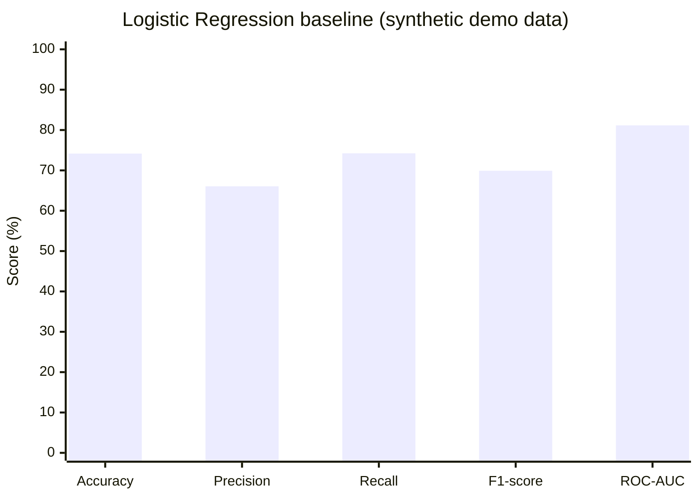
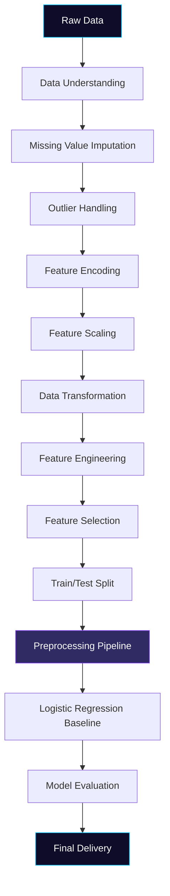

<div align="center">


<a href="https://github.com/tejpatel1034-lang/Holistic-data-prepare-credit-risk">
  
</a>

**An end-to-end, eight-day data preparation workflow that turns raw customer loan data into ML-ready datasets for credit-risk classification.**

**Author: [Tej Patel](https://github.com/tejpatel1034-lang)**

<p>
  <a href="https://github.com/tejpatel1034-lang/Holistic-data-prepare-credit-risk"></a>
  
  
  
  
  
  
</p>

</div>

---

## Table of Contents

1. [Project Overview](#project-overview)
2. [Business Problem](#business-problem)
3. [Project Objectives](#project-objectives)
4. [Dataset Overview](#dataset-overview)
5. [Technology Stack](#technology-stack)
6. [Complete Project Architecture](#complete-project-architecture)
7. [Eight-Day Workflow](#eight-day-workflow)
8. [Important Concepts](#important-concepts)
9. [Data Visualizations and Charts](#data-visualizations-and-charts)
10. [Machine Learning Pipeline](#machine-learning-pipeline)
11. [Results and Evaluation](#results-and-evaluation)
12. [Project Structure](#project-structure)
13. [Installation and Execution](#installation-and-execution)
14. [Generated Reports and Outputs](#generated-reports-and-outputs)
15. [Future Improvements](#future-improvements)
16. [Presentation Video](#presentation-video)
17. [Author](#author)
18. [Acknowledgements](#acknowledgements)

---

## Project Overview

**Holistic Data Preparer** is a structured, eight-day project that walks through the complete data preparation lifecycle for a **customer credit risk** use case. It starts with raw data acquired from several sources (CSV, JSON, SQLite) and ends with train/test datasets and a reusable scikit-learn preprocessing pipeline that are ready for modelling.

**Why data preprocessing matters.** Real-world data is rarely model-ready. It contains missing values, duplicates, outliers, text categories, features on very different scales and skewed distributions. Models trained on such data tend to be unstable, biased or misleading. Careful preparation usually has a larger effect on model quality than the choice of algorithm.

**How raw data becomes ML-ready data in this project:**

| Stage | What happens |
|---|---|
| 1. Acquire | Load data from CSV, JSON, SQLite and a dummy API |
| 2. Understand | Inspect types, missing values, duplicates, distributions and correlations |
| 3. Clean | Impute missing values and treat outliers |
| 4. Encode | Convert categorical features into numeric form |
| 5. Scale and transform | Put features on comparable scales and reduce skewness |
| 6. Engineer and select | Create derived features and keep the useful ones |
| 7. Deliver | Split train/test, fit a reusable pipeline, validate and run a baseline model |

> **Scope note:** this repository demonstrates *data preparation*. It is not a production credit-approval system.

---


## Presentation Video

### Project Walkthrough – Holistic Data Preparer

<div align="center">

### 🎥 [**Watch Project Presentation**](https://drive.google.com/file/d/1nhk0Dk_XYYphE--zDLEST5bFpwCBm5Yi/view?usp=sharing)
https://drive.google.com/file/d/1nhk0Dk_XYYphE--zDLEST5bFpwCBm5Yi/view?usp=sharing

</div>

---

## Business Problem

Financial institutions must assess **credit risk** before approving loans. Some customers fail to repay, which creates financial losses. A credit-risk classification model can help flag higher-risk applicants, but only if the data feeding it is clean, consistent and free of leakage.

**Target variable:** `default_flag`

| Value | Meaning |
|:---:|---|
| `0` | No Default |
| `1` | Default |

Properly prepared data supports a future binary classifier by ensuring that missing values are handled transparently, outliers do not dominate learning, categorical information is encoded correctly, and test data never influences training-time statistics.

**What this project is not:** a production credit approval system. It does not make lending decisions, has not been validated for regulatory use, and its results must not be used to approve or reject real applicants.

---

## Project Objectives

- Build a reproducible, step-by-step data preparation workflow across eight notebooks.
- Document every treatment decision with a report in [`reports/`](reports/).
- Compare alternative methods at each stage (imputation, outlier handling, encoding, scaling, transformation).
- Prevent data leakage by fitting transformers on training data only.
- Deliver ML-ready train/test datasets plus a saved, reusable preprocessing pipeline.
- Establish a simple Logistic Regression baseline to sanity-check the prepared data.

---

## Dataset Overview

This project works with **Synthetic Demonstration Data** for educational purposes. Data is acquired from multiple raw sources stored in [`data/raw/`](data/raw/):

| Source | File | Format |
|---|---|---|
| Acquired customer credit risk data | [`acquired_customer_credit_risk.csv`](data/raw/acquired_customer_credit_risk.csv) | CSV |
| Main customer loan data | [`main_customer_loan_data.csv`](data/raw/main_customer_loan_data.csv) | CSV |
| Customer metadata | [`customer_metadata.json`](data/raw/customer_metadata.json) | JSON |
| Loan repayment history | [`loan_repayment_history.db`](data/raw/loan_repayment_history.db) | SQLite |

**Dataset details.** Exact figures (row and column counts, numerical vs. categorical feature lists, data types, missing-value counts, duplicate counts and the train/test split) are produced by the notebooks and saved in the reports below. They are deliberately not hard-coded here, so this README never drifts from the real outputs.

| Detail | Where to find it |
|---|---|
| Data types, missing values, duplicates | [`day_02_data_quality_report.csv`](reports/day_02_data_quality_report.csv) and [`day_02_ydata_profiling_report.html`](reports/day_02_ydata_profiling_report.html) |
| Missing-value treatment | [`day_03_missing_value_treatment_report.csv`](reports/day_03_missing_value_treatment_report.csv) |
| Train/test sizes and run settings | [`day_08_run_metadata.json`](reports/day_08_run_metadata.json) |
| Final feature list | [`day_08_feature_engineering_report.csv`](reports/day_08_feature_engineering_report.csv) and [`day_08_feature_selection_report.csv`](reports/day_08_feature_selection_report.csv) |

---

## Technology Stack

| Technology | Purpose in this project |
|---|---|
|  | Core language for all notebooks and the `src/` module |
|  | Loading, cleaning, profiling and transforming tabular data |
|  | Array and tensor operations, indexing, broadcasting, reshaping |
|  | Base plotting for distributions and comparisons |
|  | Statistical plots such as boxplots and heatmaps |
|  | Imputers, encoders, scalers, `ColumnTransformer`, `Pipeline`, Logistic Regression, metrics |
|  | Interactive, documented notebooks for each day |
|  | Saving fitted scaler and pipeline objects (`.joblib`) |
|  | Source of loan repayment history |

---

## Complete Project Architecture

```text
Holistic-data-preparer/
│
├── data/
│   ├── raw/
│   │   ├── acquired_customer_credit_risk.csv
│   │   ├── customer_metadata.json
│   │   ├── loan_repayment_history.db
│   │   └── main_customer_loan_data.csv
│   │
│   ├── interim/
│   │   ├── customer_credit_risk_day02_inspection.csv
│   │   ├── customer_credit_risk_day03_imputed.csv
│   │   ├── customer_credit_risk_day03_input.csv
│   │   ├── day_08_test_raw_features.csv
│   │   └── day_08_train_raw_features.csv
│   │
│   └── processed/
│       ├── customer_credit_risk_day04_outlier_treated.csv
│       ├── customer_credit_risk_day05_encoded.csv
│       ├── customer_credit_risk_day05_test_encoded.csv
│       ├── customer_credit_risk_day05_train_encoded.csv
│       ├── customer_credit_risk_test_scaled.csv
│       ├── customer_credit_risk_train_scaled.csv
│       ├── day_08_credit_risk_pipeline.joblib
│       ├── day_08_feature_engineered.csv
│       ├── day_08_ml_ready_test.csv
│       ├── day_08_ml_ready_train.csv
│       └── robust_scaler.joblib
│
├── notebooks/
│   ├── Day_01_Conceptual_Foundation.ipynb
│   ├── Day_02_Data_Understanding.ipynb
│   ├── Day_03_Missing_Value_Imputation.ipynb
│   ├── Day_04_Outlier_Detection_and_Handling.ipynb
│   ├── Day_05_Feature_Encoding.ipynb
│   ├── Day_06_Feature_Scaling.ipynb
│   ├── Day_07_Data_Transformations.ipynb
│   └── Day_08_Final_Feature_Engineering_and_Delivery.ipynb
│
├── reports/
│   ├── day04_business_validation_report.csv
│   ├── day04_final_validation_report.csv
│   ├── day04_method_comparison.csv
│   ├── day04_outlier_treatment_summary.csv
│   ├── day04_train_fitted_capping_thresholds.csv
│   ├── day05_encoding_method_comparison.csv
│   ├── day05_final_validation_report.csv
│   ├── day05_frequency_mapping.csv
│   ├── day05_one_hot_category_mapping.csv
│   ├── day05_ordinal_mapping.csv
│   ├── day_02_data_quality_report.csv
│   ├── day_02_ydata_profiling_report.html
│   ├── day_03_missing_value_treatment_report.csv
│   ├── day_07_power_transformer_lambdas.csv
│   ├── day_07_transformation_comparison.csv
│   ├── day_08_baseline_model_metrics.csv
│   ├── day_08_feature_engineering_report.csv
│   ├── day_08_feature_selection_report.csv
│   ├── day_08_final_validation_report.csv
│   ├── day_08_output_inventory.csv
│   ├── day_08_run_metadata.json
│   └── DAY_08_DELIVERY_NOTES.md
│
├── src/
│   └── feature_engineering.py
│
├── screenshots/
├── screeenshots/
└── requirements.txt
```

> **Note on screenshot folders:** `screenshots/` and `screeenshots/` (a misspelled duplicate) currently contain no files. Git does not track empty folders, so add a `.gitkeep` file or real images if you want them to appear in the repository. Consider deleting the misspelled `screeenshots/` folder.

---

## Eight-Day Workflow

<table>
<tr>
<td width="50%" valign="top">

### Day 01 – Conceptual Foundation
📓 [`Day_01_Conceptual_Foundation.ipynb`](notebooks/Day_01_Conceptual_Foundation.ipynb)

- Data science workflow and problem framing
- NumPy tensors, indexing and slicing
- Broadcasting and reshaping
- Matrix multiplication
- Data acquisition from CSV, JSON, SQLite and a dummy API

</td>
<td width="50%" valign="top">

### Day 02 – Data Understanding
📓 [`Day_02_Data_Understanding.ipynb`](notebooks/Day_02_Data_Understanding.ipynb)

- Dataset inspection and data types
- Pandas profiling
- Missing-value and duplicate analysis
- Numerical and categorical analysis
- Correlation analysis and a data quality report

</td>
</tr>
<tr>
<td width="50%" valign="top">

### Day 03 – Missing Value Imputation
📓 [`Day_03_Missing_Value_Imputation.ipynb`](notebooks/Day_03_Missing_Value_Imputation.ipynb)

- Mean, Median and Mode imputation
- Random Sample imputation
- KNN and Iterative imputation
- Missingness indicators
- Imputation reports

</td>
<td width="50%" valign="top">

### Day 04 – Outlier Detection and Handling
📓 [`Day_04_Outlier_Detection_and_Handling.ipynb`](notebooks/Day_04_Outlier_Detection_and_Handling.ipynb)

- Interquartile Range (IQR) and Z-score detection
- Boxplots
- Outlier capping and Winsorization
- Business validation
- Before-and-after comparison

</td>
</tr>
<tr>
<td width="50%" valign="top">

### Day 05 – Feature Encoding
📓 [`Day_05_Feature_Encoding.ipynb`](notebooks/Day_05_Feature_Encoding.ipynb)

- Label, One-Hot, Ordinal and Frequency encoding
- Category mapping files
- Encoding method comparison
- Train/test data preparation

</td>
<td width="50%" valign="top">

### Day 06 – Feature Scaling
📓 [`Day_06_Feature_Scaling.ipynb`](notebooks/Day_06_Feature_Scaling.ipynb)

- StandardScaler, MinMaxScaler and RobustScaler
- Why scaling is important
- Scaling comparison
- Data leakage prevention

</td>
</tr>
<tr>
<td width="50%" valign="top">

### Day 07 – Data Transformations
📓 [`Day_07_Data_Transformations.ipynb`](notebooks/Day_07_Data_Transformations.ipynb)

- Log and Square Root transformations
- Box-Cox and Yeo-Johnson transformations
- Skewness and kurtosis
- Distribution comparison

</td>
<td width="50%" valign="top">

### Day 08 – Feature Engineering and Final Delivery
📓 [`Day_08_Final_Feature_Engineering_and_Delivery.ipynb`](notebooks/Day_08_Final_Feature_Engineering_and_Delivery.ipynb)

- Feature engineering, derived features and feature selection
- Train/test splitting
- `ColumnTransformer` and scikit-learn `Pipeline`
- Logistic Regression baseline and confusion matrix
- Model evaluation and final data validation

</td>
</tr>
</table>

---

## Important Concepts

<details>
<summary><b>Data Leakage</b></summary>

- **Definition:** information from outside the training set (for example, test-set statistics) influencing model training.
- **Why it matters:** it inflates performance and fails in production.
- **In this project:** scalers, imputers and capping thresholds are fitted on training data only (see `day04_train_fitted_capping_thresholds.csv`) and then applied to test data.
</details>

<details>
<summary><b>Imputation</b></summary>

- **Definition:** filling in missing values with estimated ones.
- **Why it matters:** most models cannot accept missing values, and careless filling distorts distributions.
- **In this project:** Day 03 compares mean, median, mode, random sample, KNN and iterative imputation, and adds missingness indicators.
</details>

<details>
<summary><b>Outliers</b></summary>

- **Definition:** values far from the bulk of the data.
- **Why it matters:** they can dominate scale-sensitive models and skew statistics.
- **In this project:** detected with IQR and Z-score, treated by capping/Winsorization and checked against business rules on Day 04.
</details>

<details>
<summary><b>Feature Encoding</b></summary>

- **Definition:** converting categorical values into numbers.
- **Why it matters:** models need numeric input, and the encoding choice changes what the model can infer.
- **In this project:** Label, One-Hot, Ordinal and Frequency encoding are compared on Day 05, with mappings saved in `reports/`.
</details>

<details>
<summary><b>Feature Scaling</b></summary>

- **Definition:** putting numeric features on comparable ranges.
- **Why it matters:** distance- and gradient-based models are sensitive to feature magnitude.
- **In this project:** Standard, MinMax and Robust scalers are compared on Day 06; the fitted `robust_scaler.joblib` is saved.
</details>

<details>
<summary><b>Feature Transformation</b></summary>

- **Definition:** applying mathematical functions (log, square root, Box-Cox, Yeo-Johnson) to reshape distributions.
- **Why it matters:** reducing skewness helps linear models and makes patterns easier to learn.
- **In this project:** Day 07 compares methods using skewness and kurtosis and stores PowerTransformer lambdas.
</details>

<details>
<summary><b>Feature Engineering</b></summary>

- **Definition:** creating new, more informative features from existing ones.
- **Why it matters:** good derived features often improve models more than algorithm changes.
- **In this project:** derived features are built on Day 08 (logic in [`src/feature_engineering.py`](src/feature_engineering.py)) and documented in `day_08_feature_engineering_report.csv`.
</details>

<details>
<summary><b>Feature Selection</b></summary>

- **Definition:** keeping only the most useful features.
- **Why it matters:** it reduces noise, overfitting and training cost.
- **In this project:** results are recorded in `day_08_feature_selection_report.csv`.
</details>

<details>
<summary><b>Pipeline</b></summary>

- **Definition:** a chained sequence of preprocessing and modelling steps.
- **Why it matters:** it guarantees identical steps at training and prediction time and helps prevent leakage.
- **In this project:** the fitted pipeline is saved as `day_08_credit_risk_pipeline.joblib`.
</details>

<details>
<summary><b>ColumnTransformer</b></summary>

- **Definition:** applies different preprocessing to different column groups.
- **Why it matters:** numeric and categorical columns need different treatment.
- **In this project:** it combines numeric and categorical preprocessing inside the Day 08 pipeline.
</details>

<details>
<summary><b>Binary Classification</b></summary>

- **Definition:** predicting one of two classes.
- **Why it matters:** it frames the credit problem as default vs. no default.
- **In this project:** the target `default_flag` is 0 (No Default) or 1 (Default).
</details>

<details>
<summary><b>Precision, Recall, F1-score and ROC-AUC</b></summary>

- **Precision:** of customers predicted as defaulters, the share who truly defaulted. It matters when false alarms are costly.
- **Recall:** of customers who truly defaulted, the share the model caught. It matters when missed defaults are costly.
- **F1-score:** the harmonic mean of precision and recall, a single balanced score.
- **ROC-AUC:** how well the model ranks defaulters above non-defaulters across all thresholds (0.5 is random, 1.0 is perfect).
- **In this project:** all four are reported for the Logistic Regression baseline on Day 08.
</details>

---

## Data Visualizations and Charts

No chart image assets are committed to the repository yet. Rather than claim charts that do not exist, each visualization below is listed with its status and its source. Generate the images with the script at the end of this section and save them to `assets/charts/` (create this folder).

| # | Chart | What it shows | Source data | Status |
|:-:|---|---|---|---|
| 1 | Missing values before vs. after imputation | Missing counts per column before and after Day 03 | [`day_03_missing_value_treatment_report.csv`](reports/day_03_missing_value_treatment_report.csv) | To generate |
| 2 | Outlier distribution before vs. after treatment | Effect of capping on boxplots | [`day04_outlier_treatment_summary.csv`](reports/day04_outlier_treatment_summary.csv) | To generate |
| 3 | Encoding method comparison | Trade-offs across encoders | [`day05_encoding_method_comparison.csv`](reports/day05_encoding_method_comparison.csv) | To generate |
| 4 | Scaling comparison | Standard vs. MinMax vs. Robust | Day 06 notebook output | To generate |
| 5 | Distribution before vs. after transformation | Skewness reduction | [`day_07_transformation_comparison.csv`](reports/day_07_transformation_comparison.csv) | To generate |
| 6 | Correlation heatmap | Feature relationships | [`day_08_ml_ready_train.csv`](data/processed/day_08_ml_ready_train.csv) | To generate |
| 7 | Feature engineering overview | Original vs. derived features | [`day_08_feature_engineering_report.csv`](reports/day_08_feature_engineering_report.csv) | To generate |
| 8 | Confusion matrix | Correct vs. incorrect predictions | Day 08 notebook | To generate |
| 9 | Model evaluation metrics | Baseline metric comparison | [`day_08_baseline_model_metrics.csv`](reports/day_08_baseline_model_metrics.csv) | Chart below (Mermaid) |

### Baseline model metrics

The chart below plots the baseline metrics listed in [Results and Evaluation](#results-and-evaluation).



**Key observation:** ROC-AUC (81.15%) is the strongest score, which suggests the model ranks defaulters above non-defaulters reasonably well. Recall (74.23%) is higher than precision (66.06%), so the baseline catches most defaulters at the cost of some false alarms.

### Reproducible chart script

Save as `src/generate_charts.py` and run it from the repository root after the notebooks have produced their outputs. Check the column names in your CSVs first and adjust where noted.

```python
"""Generate README chart assets from the project's real output files."""
from pathlib import Path

import matplotlib.pyplot as plt
import pandas as pd
import seaborn as sns

OUT = Path("assets/charts")
OUT.mkdir(parents=True, exist_ok=True)

# Chart 6: correlation heatmap of the ML-ready training data
train = pd.read_csv("data/processed/day_08_ml_ready_train.csv")
corr = train.select_dtypes("number").corr()
plt.figure(figsize=(10, 8))
sns.heatmap(corr, cmap="mako", center=0)
plt.title("Correlation Heatmap - ML-Ready Training Data")
plt.tight_layout()
plt.savefig(OUT / "correlation_heatmap.png", dpi=150)
plt.close()

# Chart 9: baseline metrics (inspect the CSV layout first and adapt if needed)
metrics = pd.read_csv("reports/day_08_baseline_model_metrics.csv")
print(metrics)  # confirm the columns before plotting
# Example for a long-format file with 'metric' and 'value' columns:
# metrics.plot.bar(x="metric", y="value", legend=False, color="#7c3aed")
# plt.savefig(OUT / "baseline_metrics.png", dpi=150, bbox_inches="tight")
```

After generating an image, embed it with `` and change its status in the table above.

---

## Machine Learning Pipeline



**Pipeline.** A scikit-learn `Pipeline` chains preprocessing steps and the model so they run in a fixed order. Calling `fit` learns every parameter from the training data only, and the same steps are then replayed on any new data.

**ColumnTransformer.** Numeric and categorical columns need different treatment. A `ColumnTransformer` routes each group of columns through its own preprocessing steps (for example imputation and scaling for numbers, imputation and encoding for categories) and joins the results into one feature matrix.

**Reuse.** The fitted object is saved as [`day_08_credit_risk_pipeline.joblib`](data/processed/day_08_credit_risk_pipeline.joblib), so the same transformations can be reloaded without repeating the notebooks.

---

## Results and Evaluation

The Day 08 notebook trains a **Logistic Regression** baseline on the prepared data. Metrics are stored in [`reports/day_08_baseline_model_metrics.csv`](reports/day_08_baseline_model_metrics.csv).

| Metric | Score | Meaning |
|---|:---:|---|
| Accuracy | **74.17%** | Share of all predictions that were correct |
| Precision | **66.06%** | Of predicted defaulters, the share who actually defaulted |
| Recall | **74.23%** | Of actual defaulters, the share the model identified |
| F1-score | **69.90%** | Balance between precision and recall |
| ROC-AUC | **81.15%** | Ability to rank defaulters above non-defaulters |

For the exact number of training and testing records, the feature count and target distribution, see [`day_08_run_metadata.json`](reports/day_08_run_metadata.json), [`day_08_final_validation_report.csv`](reports/day_08_final_validation_report.csv) and [`DAY_08_DELIVERY_NOTES.md`](reports/DAY_08_DELIVERY_NOTES.md). Target: `default_flag` (0 = No Default, 1 = Default).

> **Important:** these are educational baseline results on **synthetic demonstration data**. They are not real-world credit-risk performance and must not be used for lending decisions.

---

## Project Structure

| Path | Purpose |
|---|---|
| [`data/raw/`](data/raw/) | Original source files (CSV, JSON, SQLite), never modified |
| [`data/interim/`](data/interim/) | Intermediate datasets between stages, including raw train/test feature splits |
| [`data/processed/`](data/processed/) | Treated, encoded, scaled and ML-ready datasets plus saved `.joblib` objects |
| [`notebooks/`](notebooks/) | Eight notebooks, one per day, to be run in order |
| [`reports/`](reports/) | Validation, comparison, mapping and quality reports |
| [`src/feature_engineering.py`](src/feature_engineering.py) | Reusable feature engineering code |
| [`requirements.txt`](requirements.txt) | Python dependencies |
| `screenshots/`, `screeenshots/` | Currently empty folders (see the note in [Complete Project Architecture](#complete-project-architecture)) |

---

## Installation and Execution

**1. Clone the repository**

```bash
git clone https://github.com/tejpatel1034-lang/Holistic-data-prepare-credit-risk.git
```

**2. Navigate into the project**

```bash
cd Holistic-data-prepare-credit-risk
```

**3. Create a virtual environment**

```bash
python -m venv venv
```

**4. Activate the environment**

```bash
# Windows
venv\Scripts\activate

# Mac / Linux
source venv/bin/activate
```

**5. Install dependencies** (see [`requirements.txt`](requirements.txt))

```bash
pip install -r requirements.txt
```

**6. Launch Jupyter**

```bash
jupyter notebook
```

**7. Run the notebooks in order.** Each day reads the outputs of the previous one, so run them in sequence from Day 01 to Day 08:

| Order | Notebook |
|:-:|---|
| 1 | [`Day_01_Conceptual_Foundation.ipynb`](notebooks/Day_01_Conceptual_Foundation.ipynb) |
| 2 | [`Day_02_Data_Understanding.ipynb`](notebooks/Day_02_Data_Understanding.ipynb) |
| 3 | [`Day_03_Missing_Value_Imputation.ipynb`](notebooks/Day_03_Missing_Value_Imputation.ipynb) |
| 4 | [`Day_04_Outlier_Detection_and_Handling.ipynb`](notebooks/Day_04_Outlier_Detection_and_Handling.ipynb) |
| 5 | [`Day_05_Feature_Encoding.ipynb`](notebooks/Day_05_Feature_Encoding.ipynb) |
| 6 | [`Day_06_Feature_Scaling.ipynb`](notebooks/Day_06_Feature_Scaling.ipynb) |
| 7 | [`Day_07_Data_Transformations.ipynb`](notebooks/Day_07_Data_Transformations.ipynb) |
| 8 | [`Day_08_Final_Feature_Engineering_and_Delivery.ipynb`](notebooks/Day_08_Final_Feature_Engineering_and_Delivery.ipynb) |

---

## Generated Reports and Outputs

| Stage | Reports in [`reports/`](reports/) |
|---|---|
| Day 02 | [`day_02_data_quality_report.csv`](reports/day_02_data_quality_report.csv), [`day_02_ydata_profiling_report.html`](reports/day_02_ydata_profiling_report.html) |
| Day 03 | [`day_03_missing_value_treatment_report.csv`](reports/day_03_missing_value_treatment_report.csv) |
| Day 04 | [`day04_business_validation_report.csv`](reports/day04_business_validation_report.csv), [`day04_final_validation_report.csv`](reports/day04_final_validation_report.csv), [`day04_method_comparison.csv`](reports/day04_method_comparison.csv), [`day04_outlier_treatment_summary.csv`](reports/day04_outlier_treatment_summary.csv), [`day04_train_fitted_capping_thresholds.csv`](reports/day04_train_fitted_capping_thresholds.csv) |
| Day 05 | [`day05_encoding_method_comparison.csv`](reports/day05_encoding_method_comparison.csv), [`day05_final_validation_report.csv`](reports/day05_final_validation_report.csv), [`day05_frequency_mapping.csv`](reports/day05_frequency_mapping.csv), [`day05_one_hot_category_mapping.csv`](reports/day05_one_hot_category_mapping.csv), [`day05_ordinal_mapping.csv`](reports/day05_ordinal_mapping.csv) |
| Day 07 | [`day_07_power_transformer_lambdas.csv`](reports/day_07_power_transformer_lambdas.csv), [`day_07_transformation_comparison.csv`](reports/day_07_transformation_comparison.csv) |
| Day 08 | [`day_08_baseline_model_metrics.csv`](reports/day_08_baseline_model_metrics.csv), [`day_08_feature_engineering_report.csv`](reports/day_08_feature_engineering_report.csv), [`day_08_feature_selection_report.csv`](reports/day_08_feature_selection_report.csv), [`day_08_final_validation_report.csv`](reports/day_08_final_validation_report.csv), [`day_08_output_inventory.csv`](reports/day_08_output_inventory.csv), [`day_08_run_metadata.json`](reports/day_08_run_metadata.json), [`DAY_08_DELIVERY_NOTES.md`](reports/DAY_08_DELIVERY_NOTES.md) |

**Key deliverables** in [`data/processed/`](data/processed/):

- [`day_08_ml_ready_train.csv`](data/processed/day_08_ml_ready_train.csv) and [`day_08_ml_ready_test.csv`](data/processed/day_08_ml_ready_test.csv): final ML-ready datasets.
- [`day_08_credit_risk_pipeline.joblib`](data/processed/day_08_credit_risk_pipeline.joblib): saved preprocessing and model pipeline.
- [`robust_scaler.joblib`](data/processed/robust_scaler.joblib): fitted RobustScaler from Day 06.

---

## Future Improvements

> The items below are **planned ideas, not completed features**.

- [ ] Test on verified real-world datasets
- [ ] Advanced model comparison
- [ ] Hyperparameter tuning
- [ ] Cross-validation
- [ ] Model explainability with SHAP
- [ ] Automated data quality checks
- [ ] Production-ready preprocessing
- [ ] Model monitoring
- [ ] Deployment through FastAPI
- [ ] Reproducible experiment tracking

---

## Author

<div align="center">

### Tej Patel

**Project:** Holistic Data Preparer – Customer Credit Risk
**Role:** Data Science / AI & Machine Learning Learner

[](https://github.com/tejpatel1034-lang)

</div>

---

## Acknowledgements

- The open-source communities behind **Python, Pandas, NumPy, Matplotlib, Seaborn, scikit-learn, Jupyter and Joblib**.
- **ydata-profiling** for the automated profiling report generated on Day 02.
- [Shields.io](https://shields.io), [Capsule Render](https://github.com/kyechan99/capsule-render) and [readme-typing-svg](https://github.com/DenverCoder1/readme-typing-svg) for the badges, banner and typing animation.

---

<div align="center">

**Built by [Tej Patel](https://github.com/tejpatel1034-lang)** · Educational project using synthetic demonstration data


</div>
